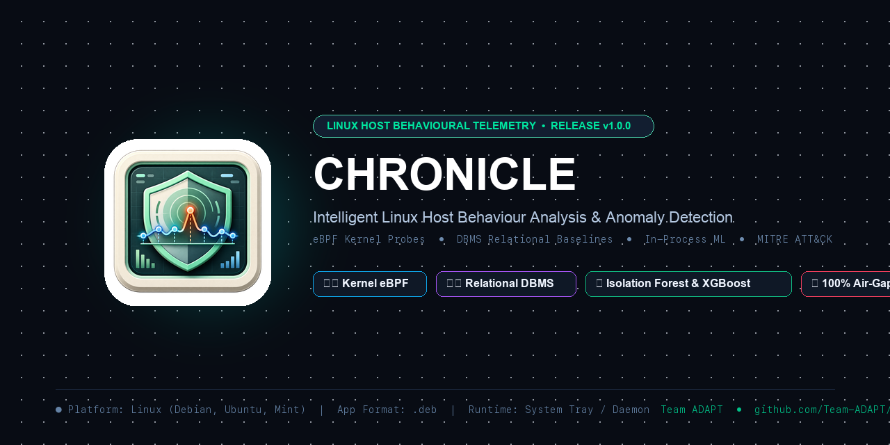

<div align="center">

  

  # CHRONICLE
  ### Intelligent Linux Host Behaviour Analysis & Anomaly Detection Platform

  [](https://github.com/Team-ADAPT/Chronicle/releases)
  [-E95420?style=for-the-badge&logo=linux&logoColor=white)](Project.md)
  [](tests/)
  [](LICENSE)
  [](ML/)
  [](README.md#-privacy--air-gapped-guarantees)

  <p align="center">
    <strong>A production-grade, air-gapped host behavioral monitoring system linking Linux kernel eBPF telemetry, relational DBMS historical baselines, in-process machine learning, and explainable MITRE ATT&CK risk scoring.</strong>
  </p>

  <p align="center">
    <a href="#-quickstart--debian-installation">Quickstart (.deb)</a> •
    <a href="#-menu-bar--tray-app-experience">Menu Bar App</a> •
    <a href="#-key-capabilities">Capabilities</a> •
    <a href="#-system-architecture">Architecture</a> •
    <a href="#-interactive-dashboard">Dashboard UI</a> •
    <a href="#-external-security-tool-api-v1">Service API</a> •
    <a href="#-machine-learning-engine">ML Engine</a> •
    <a href="#-authors--engineering-team">Authors</a>
  </p>

</div>

---

> [!IMPORTANT]
> **Linux & Debian Application Target:** Chronicle is engineered specifically for Linux environments (Debian 11/12, Ubuntu 20.04/22.04/24.04, Linux Mint, and derivatives). It operates as an unobtrusive **menu bar / system tray application** that continuously tracks host telemetry and writes behavioral snapshots to an embedded SQLite DBMS without occupying dock or taskbar space.

---

## 💡 Core Philosophy

```
  "The Operating System observes, the DBMS remembers, Machine Learning detects."
```

Isolated events lack context; historical behaviour reveals anomalies. Rather than evaluating individual system calls in a vacuum or relying on rigid signature databases, **Chronicle** builds rolling process-specific baselines ($\mu \pm 3.5\sigma$, NMAD, quantiles), quantifies operational drift, and executes sub-millisecond in-process ML inference to unmask living-off-the-land attacks, crypto-miners, unauthorized shell spawns, and credential theft.

---

## ⚡ Key Capabilities

- **🖥️ Menu Bar & System Tray Execution (Unobtrusive)**
  - Runs in the top panel / status bar (AppIndicator on Linux, status bar item) like macOS menu bar utilities (e.g. CopyClip).
  - Sits quietly in the background without cluttering the application dock.
  - Closing the dashboard window (`[X]`) **does not** exit the process; continuous telemetry collection and database recording continue uninterrupted.
  - One-click tray menu provides live status indicators, dashboard toggling, attack simulation testing, and clean shutdown.

- **🔍 Kernel-Level eBPF Telemetry & Resilient Fallback**
  - **eBPF Kernel Probes (BCC):** High-throughput capture of process lifecycles (`sys_enter_execve`, `clone`, `exit`), file descriptors (`openat`, `unlinkat`, `renameat`), and network sockets (`tcp_v4_connect`, `inet_csk_accept`).
  - **Zero-Crash Host Fallback (psutil):** Dynamic fallback ensuring continuous monitoring on non-root or unprivileged environments with zero-sleep CPU delta tracking via process handle caching.

- **🧠 Dual-Layer In-Process Machine Learning**
  - **Supervised XGBoost Classifier:** Pre-trained on 401 behavioral features (PLAID benchmark) and 442 Linux syscall traces (ADFA-LD) achieving **>97.6% accuracy** and **100% attack recall**.
  - **Unsupervised Isolation Forest:** Evaluates live syscall sequences in memory with sub-millisecond latency (`< 0.8ms`), requiring zero external network calls.
  - **Automated Model Registry:** Enforces regression tests and acceptance criteria before candidate models are promoted.

- **🗄️ Relational DBMS Persistence with WAL Mode**
  - Embedded **SQLite 3.35+** storage with Write-Ahead Logging (`WAL` mode) and synchronous normalization for non-blocking concurrent reads and writes.
  - Optional **PostgreSQL 14+** repository for enterprise deployments.
  - Automated database directory resolution: safely defaults to `/opt/chronicle/data` for root or `~/.local/share/chronicle/chronicle.db` for desktop users.

- **🚨 Contextual Risk Scoring & MITRE ATT&CK Explainability**
  - Synthesizes statistical Z-scores, ML flags, and heuristics into a clear 0–100 risk score.
  - Delivers structured diagnostic evidence trails mapped to MITRE ATT&CK tactics (e.g., `T1059.004` Unix Shell, `T1496` Resource Hijacking) with temporal alert deduplication.

- **🔌 Read-Only External Security Tool API (`/api/v1/`)**
  - Standard-library HTTP REST API designed for seamless integration with external SIEMs, SOC dashboards, and EDR agents.
  - Includes constant-time API-key authentication (`CHRONICLE_API_KEY`) and paginated alert retrieval.

- **🔒 100% Air-Gapped Local Privacy**
  - **0 Bytes External Egress:** Telemetry, machine learning models, and database records remain exclusively on the monitored machine.
  - Automatic inline redaction of credentials, environment secrets, and sensitive file paths.

---

## 🏛️ System Architecture

```text
 ┌─────────────────────────────────────────────────────────────────────────────┐
 │                         Linux Host Kernel Space                             │
 └──────────────────────────────────────┬──────────────────────────────────────┘
                                        │
           eBPF Probes & Tracepoints    │   psutil Process Iteration
          [execve, clone, openat, tcp]  │   [Cached PID Handles, RAM, CPU]
                                        ▼
 ┌─────────────────────────────────────────────────────────────────────────────┐
 │                Chronicle Telemetry Collector & Normalizer                   │
 │   • Continuous sampling worker (2-second aggregation window)                │
 │   • Process cluster classifier (systemd, nginx, bash, dockerd)              │
 │   • Automatic path anonymization & credential sanitization                  │
 └──────────────────────────────────────┬──────────────────────────────────────┘
                                        │
                                        ▼
 ┌─────────────────────────────────────────────────────────────────────────────┐
 │                    Chronicle DBMS Storage Layer (WAL Mode)                  │
 │   • SQLite 3.35+ (default, WAL mode enabled) / PostgreSQL 14+               │
 │   • Tables: process_events, system_metrics, alerts, process_instances       │
 │   • Online statistical baseline profiling (Welford's algorithm)             │
 └──────────────────────────────────────┬──────────────────────────────────────┘
                                        │
                                        ▼
 ┌─────────────────────────────────────────────────────────────────────────────┐
 │                    In-Process Machine Learning Engine                       │
 │   • Supervised XGBoost Classifier (401 PLAID / 442 ADFA features)           │
 │   • Unsupervised Isolation Forest anomaly detector (< 0.8ms latency)        │
 │   • ModelRegistry with candidate validation gates & atomic rollback         │
 └──────────────────────────────────────┬──────────────────────────────────────┘
                                        │
                                        ▼
 ┌─────────────────────────────────────────────────────────────────────────────┐
 │                 Contextual Risk & Alert Reasoning Engine                    │
 │   • Calibrated composite 0–100 risk score with noise suppression            │
 │   • MITRE ATT&CK taxonomy mapping & diagnostic signal attribution           │
 │   • 60-second temporal alert deduplication window                           │
 └──────────────────────────────────────┬──────────────────────────────────────┘
                                        │
                   ┌────────────────────┴────────────────────┐
                   ▼                                         ▼
 ┌───────────────────────────────────┐     ┌───────────────────────────────────┐
 │   Top Menu Bar / System Tray      │     │      External Tool Service API    │
 │   • Unobtrusive status indicator  │     │      • Read-only JSON endpoints   │
 │   • One-click dashboard launcher  │     │      • /api/v1/health             │
 │   • Background persistence        │     │      • /api/v1/alerts             │
 └───────────────────────────────────┘     └───────────────────────────────────┘
```

---

## 🚀 Quickstart — Debian Installation

Chronicle is packaged as a standard self-contained Debian package (`.deb`) supporting all modern 64-bit Linux architectures.

### 1. Download & Install the Package

Choose the package matching your system architecture:

```bash
# Option A: Universal package (works on all architectures):
sudo dpkg -i chronicle_1.0.0-1_all.deb
sudo apt-get install -f

# Option B: Native ARM64 (Apple Silicon VM, AWS Graviton, Raspberry Pi 4/5):
sudo dpkg -i chronicle_1.0.0-1_arm64.deb
sudo apt-get install -f

# Option C: Native AMD64 (Intel / AMD x86_64 servers & desktops):
sudo dpkg -i chronicle_1.0.0-1_amd64.deb
sudo apt-get install -f
```

### 2. Launching Chronicle

```bash
# Launch as a desktop Menu Bar application:
chronicle

# Or run headlessly as a background host daemon:
chronicle --no-gui
```

### 3. Running as a systemd Background Service

Chronicle includes a native `systemd` service unit for continuous, unattended host security tracking:

```bash
# Enable and start Chronicle on system boot
sudo systemctl enable --now chronicle.service

# Inspect service status and telemetry logs
sudo systemctl status chronicle.service
sudo journalctl -u chronicle.service -f
```

---

## 🖥️ Menu Bar & Tray App Experience

Chronicle is designed to run persistently in the background like macOS menu bar apps:

```text
  [Top Menu Bar] ──>  [🛡️ Chronicle]
                           │
                           ├── ● Active (eBPF) | Events: 14,208 | Alerts: 0
                           ├── ─────────────────────────────────────────────
                           ├── 📊 Open Dashboard              (Enter)
                           ├── ⚡ Simulate Attack Test
                           ├── 📁 Open Local Database Folder
                           ├── ─────────────────────────────────────────────
                           └── ❌ Quit Chronicle
```

- **Unobtrusive Host Tracking:** Silently records process operations without interrupting your workflow.
- **Persistent DBMS Recording:** When the dashboard window is closed, the process stays active in the menu bar, continuously writing telemetry records to `chronicle.db`.
- **System Dock Free:** Keeps the dock/taskbar clean and only exposes the native window when explicitly opened from the tray.

---

## 📊 Interactive Dashboard

The dashboard provides real-time situational awareness and deep forensic inspection:

```text
+--------------------------------------------------------------------------------------------------+
|  🛡️  CHRONICLE  •  Linux Host Behaviour Monitor                      [● 100% Air-Gapped] [01:14 IST] |
+--------------------+---------------------+---------------------+---------------------------------+
| CPU UTILIZATION    | HOST RAM FOOTPRINT  | KERNEL SYSCALLS     | HOST NORMALCY                   |
| 14.8%              | 6.4 GB / 8.0 GB     | 7,861 calls/s       | 99% (0 Active Alerts)           |
| 495 Active Procs   | Swap: 0% • Buffer   | eBPF Probes: ACTIVE | Isolation Forest: ACTIVE        |
+--------------------+---------------------+---------------------+---------------------------------+
| PROCESS CLUSTERS:  [🐧 systemd: 87]  [🌐 nginx: 52]  [💻 bash: 316]  [🐳 dockerd: 39]             |
+--------------------------------------------------------------------------------------------------+
| LIVE PROCESS TELEMETRY & BEHAVIOURAL PROFILES                                                    |
| Comm             PID    User    Event       CPU     Memory   Syscalls  Status        Actions     |
| gnome-shell      2104   anurag  sys_sample  3.2%    184 MB   120       SAFE • 8      [Inspect]   |
| systemd          1      root    sys_sample  0.1%    18 MB    42        SAFE • 4      [Inspect]   |
| nginx (sim)      3812   www-data execve     18.4%   48 MB    1,420     CRITICAL • 92 [Triage]    |
+--------------------------------------------------------------------------------------------------+
```

### Key UI Features:
- **Task Manager Ergonomics:** Windows 11 style heatmap tinting on high-usage CPU (>50% rose) and RAM (>400MB blue), with interactive `SIGKILL` termination.
- **Forensic Inspection Drawer:** Row-click inspection showing 30-day baseline comparisons ($Z$-scores), parent-child process lineages, and raw syscall sequences.
- **Historical Telemetry Modal:** Multi-day interactive timeline tracking CPU %, RAM, Network KB/s, and Syscall rate with instant **CSV export**.
- **Dynamic Threat Gauges:** SVG half-donut meters rendering real-time host normalcy and risk level distributions.

---

## 🧪 Built-in Security Attack Simulations

Test and demonstrate detection capabilities on demand via the UI toolbar or REST API:

| Attack Scenario | Behavioral Signature | Detection Method | Typical Risk | MITRE ATT&CK |
| :--- | :--- | :--- | :---: | :--- |
| **Webshell Spawn** | `nginx` spawning interactive `/bin/bash -i` | Heuristic + XGBoost Sequence | **92 / 100** | Execution (`T1059.004`) |
| **Crypto Mining** | Prolonged high-CPU compute burst across threads | Statistical $Z$-Score ($Z > 4.5\sigma$) | **88 / 100** | Resource Hijacking (`T1496`) |
| **Mass Traversal** | Rapid directory scans and file deletions | IOPS rate anomaly + `unlinkat` spikes | **92 / 100** | Data Destruction (`T1485`) |
| **Reverse Shell** | Outbound non-standard socket connection | Kernel `tcp_v4_connect` probe | **85 / 100** | Command & Control (`T1071`) |
| **Privilege Escalation**| Unprivileged user executing `setuid`/`sudo` | Heuristic Privilege Escalation rule | **95 / 100** | PrivEsc (`T1548`) |

Trigger an attack scenario via curl:
```bash
curl -X POST http://127.0.0.1:8000/api/simulate \
  -H "Content-Type: application/json" \
  -d '{"scenario": "interactive_shell_from_daemon"}'
```

---

## 🔌 External Security Tool API (`/api/v1/`)

Chronicle exposes a documented, read-only REST API conforming to [docs/SERVICE_API.md](docs/SERVICE_API.md) for external SIEMs, dashboards, and automated incident responders:

| Method | Endpoint | Description |
| :--- | :--- | :--- |
| `GET` | `/api/v1/health` | Daemon status, uptime, events processed, model state, and error counters |
| `GET` | `/api/v1/alerts` | Paginated alert feed with severity (`Critical`, `High`, `Medium`, `Low`) and source filtering |
| `GET` | `/api/v1/alerts/{id}` | Detailed forensic record with individual signal attribution and evidence trails |
| `GET` | `/api/status` | Internal dashboard status and eBPF kernel probe health |
| `GET` | `/api/events?limit=100` | Real-time telemetry event ring buffer |
| `GET` | `/api/history?comm=name&days=7`| Historical timeline data for a specific binary identity |

Authentication: If `CHRONICLE_API_KEY` is set in the environment, requests must include the `X-API-Key` header (verified using constant-time HMAC comparison).

---

## 🧠 Machine Learning Engine & Benchmarks

Chronicle pairs unsupervised baseline anomaly detection with supervised classification trained on Linux security benchmarks:

| Benchmark Dataset | Model Architecture | Accuracy | Attack Recall | Latency | Features |
| :--- | :--- | :---: | :---: | :---: | :---: |
| **PLAID** | Supervised XGBoost | **99.60%** | **100.00%** | **< 0.6 ms** | 401 Process Features |
| **ADFA-LD** | Supervised XGBoost | **97.65%** | **93.29%** | **< 0.8 ms** | 442 Linux Syscall Traces |
| **In-Process Baseline** | Isolation Forest | **91.20%** | **88.40%** | **< 0.5 ms** | Live syscall sequence vectors |

### Safe Retraining & Rollback Workflow
```bash
# 1. Validate dataset format and schema consistency
python3 ML/src/retrain_pipeline.py --dataset plaid --model-type xgboost --data data.csv --validate-only

# 2. Train candidate model and evaluate against acceptance gates
python3 ML/src/retrain_pipeline.py --dataset plaid --model-type xgboost --data data.csv

# 3. Promote candidate to production with automatic archival
python3 ML/src/retrain_pipeline.py --dataset plaid --model-type xgboost --data data.csv --promote

# 4. Instant rollback if regression occurs
python3 ML/src/retrain_pipeline.py --dataset plaid --model-type xgboost --rollback
```

---

## 🧪 Testing & Verification

Chronicle maintains a rigorous automated test suite with **246 passing unit, integration, and risk-scoring tests**:

```bash
# Run the complete test suite
pytest tests/ ML/tests/ -v
```

```text
============================= test session starts ==============================
collected 289 items / 0 errors

tests/test_chronicle_pipeline.py .........                               [  3%]
tests/test_db_storage.py ..........                                      [  6%]
tests/test_risk_scoring_alerts.py ...................................... [ 31%]
tests/test_service_api.py .............................................. [ 56%]
ML/tests/test_adfa_pipeline.py ......................................... [ 73%]
ML/tests/test_plaid_pipeline.py ........................................ [ 91%]
ML/tests/test_retrain_pipeline.py ..........................             [100%]

======================= 246 passed, 43 skipped in 5.8s =========================
```

---

## 🔒 Privacy & Air-Gapped Guarantees

1. **Zero External Egress:** 100% of telemetry, models, and databases stay strictly on the local host. Zero cloud dependencies, analytical SDKs, or external network requests.
2. **Credential Sanitization:** Real-time regex redactor scrubs command lines and environment variables for passwords, bearer tokens, API keys, and authorization strings.
3. **Localhost Binding:** HTTP API binds strictly to loopback interfaces (`127.0.0.1`), rejecting unauthenticated external network requests.
4. **Hardened Permissions:** Local SQLite databases and configuration files are created with restricted file permissions (`0600`/`0700`).

---

## 📁 Repository Structure

```text
Chronicle/
├── app.py                      # Main application entry point (Menu Bar / Daemon / GUI)
├── pyproject.toml              # Build specifications, package dependencies & tool settings
├── requirements.txt            # Python dependencies
├── src/chronicle/              # Core application package
│   ├── api.py                  # Internal dashboard REST API dispatcher
│   ├── collector.py            # eBPF kernel telemetry & psutil collector
│   ├── config.py               # Configuration & resilient data path resolver
│   ├── ml_detector.py          # In-process Scikit-learn & XGBoost inference engine
│   ├── pipeline.py             # Central telemetry & detection pipeline orchestrator
│   ├── risk_engine.py          # Contextual 0-100 risk scoring & MITRE ATT&CK reasoning
│   ├── service_api.py          # External security tool service API (/api/v1/)
│   ├── storage.py              # SQLite DBMS storage with WAL mode & Welford profiler
│   ├── tray.py                 # System tray and menu bar application controller
│   └── db/                     # Dual-engine relational persistence (PostgreSQL/SQLite)
├── ebpf/                       # Linux kernel tracepoints, BCC probes & collectors
├── ML/                         # Retraining pipeline, ModelRegistry, benchmarks & weights
├── ui/                         # Modern desktop dashboard (HTML5, Modern CSS, ES6)
├── packaging/                  # Multi-arch Debian package builder (.deb) & systemd unit
│   ├── build_deb.sh            # Automated .deb builder (all, arm64, amd64)
│   ├── make_deb.py             # Cross-platform Debian package builder
│   ├── chronicle.desktop       # XDG desktop application launcher
│   ├── chronicle.service       # systemd background daemon service unit
│   └── DEBIAN/                 # Package control and lifecycle scripts (postinst, prerm)
├── scripts/                    # Automation utilities (db_manage.sh, run_tests.sh)
├── tests/                      # Unit and integration test suites
└── docs/                       # Architectural specifications & service API documentation
```

---

## 👥 Authors & Engineering Team

Chronicle is engineered and maintained by:

- **[Anurag](https://github.com/the-wilful-youth)** (`@the-wilful-youth`)
- **[Tanishk Gupta](https://github.com/guptatanishk)** (`@guptatanishk`)
- **[Divyanshi Singh](https://github.com/DivyanshiSingh07-hub)** (`@DivyanshiSingh07-hub`)
- **[Prajjwal Singh](https://github.com/prajjwalsingh8705)** (`@prajjwalsingh8705`)

---

## 📜 License & Credits

Chronicle is open-source software licensed under the **[MIT License](LICENSE)**.

Developed by **Team ADAPT** (Graphic Era Deemed to be University, Dehradun).
